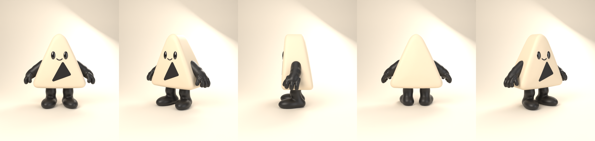
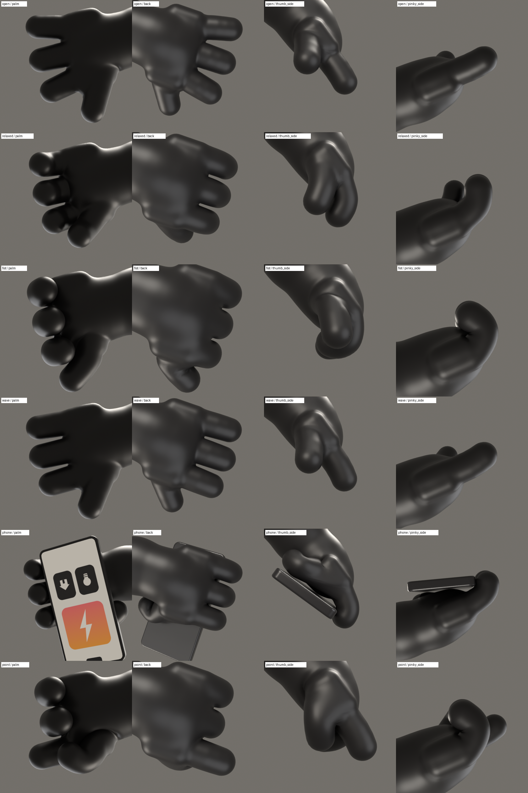
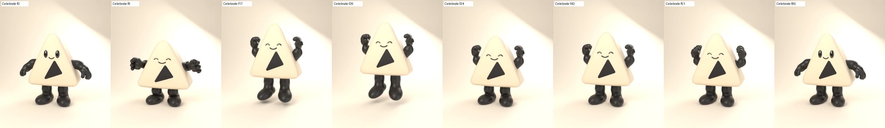

# Mascota 3D ▲ — personaje completo, riggeado y animado

Mascota de marca construida **desde cero** a partir de la referencia `reference/mascot_reference.jpg`:
cuerpo triangular crema de vinilo, ojos ovalados negros brillantes, boca/emblema triangular negro,
sonrisa pequeña, brazos y piernas negros cartoon con pies grandes y manos cartoon de **cuatro dedos** (pulgar oponible + tres dedos), todos articulados.

Todo el personaje (geometría, materiales, esqueleto, pesos, controles, poses de mano y animaciones)
se genera con un pipeline reproducible en Python para Blender. No hay imágenes planas: el teléfono, los ojos,
la boca y cada dedo son geometría 3D real.



## Entregables

| Archivo | Contenido |
|---|---|
| `export/mascot.blend` | Proyecto editable de Blender 4.2: mallas, materiales, rig IK/FK con controles, 7 acciones, biblioteca de poses de mano, estudio de iluminación y cámara. |
| `export/mascot.glb` | Modelo para web / tiempo real: mallas, materiales PBR, esqueleto (48 huesos de deformación), skinning y 7 animaciones. |
| `export/mascot.fbx` | Mismo contenido para motores y DCCs (Unity, Unreal, Maya…). Incluye además `CTRL_Root` y `CTRL_COG` como raíz de la jerarquía (50 huesos). |
| `web/index.html` | Visor web en three.js que carga el GLB real (órbita, cambio de animación, ver esqueleto). |
| `renders/` | Renders de control: turnaround, hoja de poses de mano, hojas de cada animación, renders “hero” e informe de QA. |
| `blender/` | Código fuente del personaje (ver “Cómo reconstruirlo”). |

## Cómo verlo

* **Blender**: abre `export/mascot.blend`. La acción activa es `Idle`; las 7 animaciones están en el
  Action Editor y como pistas NLA. Colecciones: `MASCOT_Body`, `MASCOT_Limbs`, `MASCOT_Hands`,
  `MASCOT_Accessories`, `MASCOT_Materials` (esferas muestra de cada material), `MASCOT_Rig`, `WGT_Widgets`, `STUDIO`.
* **Web**: sirve la carpeta `web/` con cualquier servidor estático y abre `index.html`:

  ```bash
  python3 -m http.server -d web 8000
  ```

  Luego visita `http://localhost:8000`. Parámetros opcionales: `?clip=Wave`, `?model=otra.glb`.

## Cómo reconstruirlo

Requiere Blender 4.2 LTS (probado con 4.2.3) y, para las hojas de contacto, Python 3 con Pillow.

```bash
tools/build_all.sh /ruta/a/blender
```

O paso a paso:

```bash
blender -b --factory-startup -P blender/build_mascot.py
```

```bash
blender -b export/mascot.blend -P blender/qa_check.py
```

```bash
blender -b export/mascot.blend -P blender/render_qa.py -- all
```

```bash
python3 tools/make_sheets.py
```

El build tarda unos 2–3 minutos en CPU y es determinista.

### Estructura del código

| Módulo | Función |
|---|---|
| `blender/mascot_lib/design.py` | **Fuente única de medidas**: silueta del cuerpo, cara, articulaciones, anatomía de la mano, funciones de distancia con signo (SDF) y cálculo de pesos. |
| `blender/mascot_lib/sdf.py`, `meshing.py` | Primitivas SDF y mallado “surface nets” a quads con relajación y re-proyección exacta sobre la superficie. |
| `blender/mascot_lib/geometry.py` | Construye cada malla, retopología en quads (QuadriFlow) y re-proyección sobre la superficie analítica; teléfono y su pantalla con UVs. |
| `blender/mascot_lib/materials.py` | Materiales Principled BSDF compatibles con glTF. |
| `blender/mascot_lib/rig.py` | Esqueleto, cadenas DEF/FK/IK, interruptores IK/FK, controles de agarre, formas de control, colecciones de huesos y skinning. |
| `blender/mascot_lib/solver.py` | Resolvedor de contactos de la mano (cápsulas por falange): pulgar sobre el puño, agarre del teléfono, separación entre dedos. |
| `blender/mascot_lib/poses.py` | Biblioteca de poses de mano y utilidades de pose con espejo automático L/R. |
| `blender/mascot_lib/animations.py` | Las 7 animaciones de prueba. |
| `blender/mascot_lib/export.py` | Exportación GLB y FBX (solo huesos de deformación, animación horneada). |

## Modelo

* **Cuerpo-cabeza único**: triángulo con lados ligeramente convexos, base ancha, esquinas redondeadas
  (radio mayor en la punta) y volumen acolchado: canto redondeado, caras delantera/trasera infladas,
  más grueso abajo que arriba (la cara trasera se inclina hacia delante, como en las vistas laterales de la referencia).
  Sin cuello ni torso separado.
* **Cara**: ojos ovalados verticales ligeramente salientes con material negro de laca (reflejo especular
  blanco como en la referencia); sonrisa pequeña; **boca/emblema triangular** negra con relieve de 2,5 mm y bordes
  biselados que sigue la curvatura del cuerpo. Arcos de ojos “felices” (^ ^) ocultos bajo la superficie, que el rig
  saca para la expresión de celebración.
* **Brazos y manos**: una sola malla continua por lado (hombro → codo → muñeca → palma → dedos), sin costuras.
  Mano cartoon de cuatro dedos: tres dedos gruesos y redondeados con longitudes progresivas (corazón > índice > anular),
  cada uno con tres falanges, y un pulgar oponible de tres segmentos. Palma reconocible (dorso abombado, eminencia tenar e
  hipotenar, ligero hueco palmar). Los dedos están separados en la malla de reposo.
* **Piernas y pies**: piernas negras cortas y gruesas, pies grandes redondeados con suela plana, ligeramente abiertos.
* **Topología**: quads limpios (QuadriFlow) re-proyectados sobre la superficie analítica.
  Unos 139 000 triángulos en total en el GLB.

## Rig

Todos los nombres siguen la convención `DEF_` (deforma), `FK_` / `CTRL_` (controles) y `MCH_` (mecanismo),
con sufijos `.L` / `.R`. Formas de control personalizadas y colecciones de huesos: *Root, Body, Face, Arm FK,
Arm IK, Leg FK, Leg IK, Fingers, Props* (visibles) y *Deform, Mechanism* (ocultas).

| Control | Uso |
|---|---|
| `CTRL_Root` | Control principal del personaje. Lleva las propiedades `IK_Arm.L/R` e `IK_Leg.L/R` (0 = FK, 1 = IK). |
| `CTRL_COG` | Centro de gravedad: mueve cuerpo, brazos y caderas (saltos, balanceo). |
| `DEF_Body` | Rotación/inclinación del cuerpo. |
| `DEF_BodyShape` | Escala del cuerpo para respiración y squash & stretch (el resto del rig no hereda la escala, así que la silueta solo se escala de forma suave y uniforme). |
| `FK_UpperArm / FK_Forearm / FK_Hand` | Brazo en FK (hombro, codo, muñeca). |
| `CTRL_IK_Hand` + `CTRL_Pole_Arm` | Brazo en IK con vector polar (codo). |
| `FK_Thigh / FK_Shin / FK_Foot`, `DEF_Toe` | Pierna en FK, cadera, rodilla, tobillo y punta del pie. |
| `CTRL_IK_Foot` + `CTRL_Pole_Leg` | Pierna en IK con polar de rodilla (pies plantados). |
| `DEF_Index/Middle/Ring/Thumb_01..03` | Dedos en FK. Rotación X = flexión, Z = separación. En los nudillos la separación se aplica antes que la flexión (orden ZYX), como una articulación real, así un dedo separado mantiene su propio plano de flexión. |
| `CTRL_Grip` | Control de agarre: su rotación X (−15° a 95°, Y/Z bloqueados) cierra los tres dedos a la vez y se suma a la pose de cada dedo. Las falanges tienen límites de rotación anatómicos. |
| `CTRL_ThumbGrip` | Agarre del pulgar. |
| `DEF_Prop.L/R` | Zócalo de objetos: el teléfono está emparentado aquí, así que se puede mover o reorientar sin tocar la geometría de la mano. |
| `DEF_Eye`, `DEF_EyeHappy`, `DEF_Smile`, `DEF_Mouth` | Controles faciales independientes: mirada (traslación), parpadeo (escala Y), ojos felices, ancho de sonrisa y boca. |

Los ángulos polares del IK se calibran automáticamente para que el cambio de FK a IK no mueva la pose de reposo
(residuo < 0,001).

**Pesos**: calculados a partir de la anatomía del diseño. Cada vértice pertenece suavemente a un grupo
(brazo, palma, cada dedo, pulgar) según su campo de distancia, y dentro del grupo se reparte entre los huesos de
la cadena según la distancia a cada segmento, con una suavidad proporcional al grosor local del miembro.
Después se suaviza sobre la malla y se limita a 4 influencias por vértice (compatible con glTF / three.js).
El cuerpo y los elementos de la cara son rígidos respecto a su hueso, así que la silueta triangular nunca se deforma.

## Poses de mano

Guardadas como acciones `HandPose_*` en el `.blend` y comprobadas desde palma, dorso y ambos laterales
(`renders/hand_poses.png`): **abierta** (los cuatro dedos separados), **relajada**, **puño** (pulgar sobre las
falanges medias de índice y corazón), **saludo**, **teléfono** y **señalar** (índice extendido).
El puño, el señalar y el agarre del teléfono los ajusta el resolvedor de contactos. En el puño cada dedo se cierra hasta
que la yema apoya en la palma (holgura de unos 0,7 mm, sin hundirse) y el pulgar se apoya en el lateral del índice.
En el agarre cada dedo se cierra hasta tocar el borde del teléfono sin atravesarlo.



## Teléfono

Objeto independiente (`PROP_Phone` + `PROP_PhoneScreen`): carcasa negra de esquinas redondeadas, pantalla
rebajada con UVs y textura (mosaico naranja con el rayo, mosaicos de bombilla y casa, notch). El agarre lo
calcula el resolvedor: la palma apoya en la parte trasera, los tres dedos envuelven el borde exterior
(como en la referencia) y el pulgar sujeta el borde opuesto. La colocación se comprueba después contra la malla
deformada real de la mano y se separa hasta que no hay interpenetración (ver el informe de QA).

## Animaciones (24 fps)

| Clip | Fotogramas | Descripción |
|---|---|---|
| `Idle` (Reposo) | 0–96, bucle | Respiración sutil, balanceo de brazos, parpadeo. |
| `Wave` (Saludo) | 0–72, bucle | Levanta la mano derecha en arco, saluda con la muñeca y ondula los dedos. |
| `Celebrate` (Celebración) | 0–60 | Anticipación, salto con ambos brazos arriba y puños cerrados, ojos felices, aterrizaje con squash. |
| `Walk` (Caminata) | 0–32, bucle (en el sitio) | Ciclo coordinado: pies con apoyo de talón y despegue sin atravesar el suelo, brazos en oposición, rebote y balanceo del cuerpo. |
| `Phone` (Teléfono) | 0–96, bucle | Sostiene el teléfono en alto con la mano izquierda mostrando la pantalla, con un ligero balanceo, y la mano derecha hace un gesto de presentación con la palma hacia arriba. |
| `Fist` (Puño) | 0–48, bucle | Ambas manos se cierran en puño y se abren. Los dedos se cierran escalonados y el pulgar se pliega al final (y se abre primero), así nunca atraviesa el índice. |
| `Present` (Presentación) | 0–72 | Anticipación, señala hacia un lado con el índice y mantiene la pose. |

Cada clip incluye claves de todos los controles, así que se reproduce de forma independiente.
Ninguna animación usa movimientos de cámara.



## Control de calidad

`blender/qa_check.py` mide sobre las mallas deformadas reales (cada 2 fotogramas de cada clip y cada pose de mano):
suela respecto al suelo, manos y teléfono dentro del cuerpo, intersecciones entre dedos distintos (BVH de
triángulos) y variación de escala del cuerpo. El resultado está en `renders/qa_report.md` y `renders/qa_report.json`.
El visor web se probó en Chromium headless con el GLB exportado (las 7 animaciones y los 48 huesos se cargan y reproducen).

## Decisiones de diseño y límites conocidos

* **Manos de cuatro dedos**: la referencia dibuja manos tipo manopla. A petición del cliente la mano tiene cuatro dedos
  (pulgar + tres), el estándar de las mascotas cartoon, con dedos gruesos y redondeados de estilo vinilo.
* **Boca**: la referencia muestra a la vez una sonrisa pequeña y un gran triángulo negro. Se modelaron ambos: el
  triángulo como boca/emblema (con hueso propio) y la sonrisa como línea fina, también con control.
* **Puño**: con dedos tan gruesos y cortos, el puño queda como una "bola" cartoon; el pulgar apoya en el lateral del
  índice y el informe de QA registra un contacto leve entre ambos (unos 20 pares de triángulos) en el puño y en la
  celebración. Es el único choque entre dígitos que queda.
* **Pliegues de flexión**: con skinning lineal (el que usan glTF y three.js), la piel del interior de una articulación
  muy flexionada se comprime y algunos triángulos de ese pliegue interior se solapan. No es visible desde fuera
  y el informe de QA lo cuenta por separado de los choques entre dedos distintos.
* **Proporciones**: medidas sobre la referencia (cuerpo ancho/alto ≈ 0,97; piernas + pies ≈ 36 % del alto del cuerpo;
  brazos ≈ 18 % y piernas ≈ 20 % del ancho del cuerpo).
* **Escala**: 1 unidad = 1 m. El personaje mide unos 1,5 m con un cuerpo de 1,1 m.
